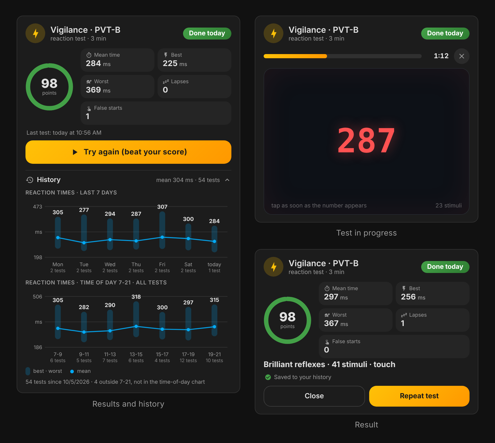
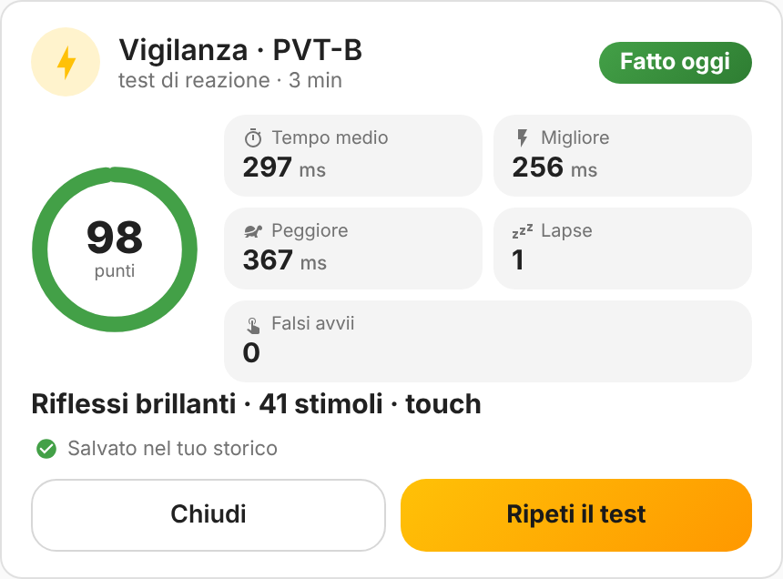

# PVT-B Vigilance Card

[](https://hacs.xyz/docs/faq/custom_repositories/)
[](https://github.com/artech-lab/pvt-vigilance-card/releases)
[](https://github.com/artech-lab/pvt-vigilance-card/actions/workflows/validate.yml)
[](LICENSE)

[English](README.md) | **Italiano**

Una card per le dashboard di Home Assistant che esegue il **test di vigilanza psicomotoria breve da
3 minuti (PVT-B)** e conserva uno storico permanente dei tuoi tempi di reazione. Aggiungi la card e
inizia: niente helper, niente YAML, nessun riavvio.



<sub>Immagini realizzate con dati dimostrativi.</sub>

## Caratteristiche

- **Protocollo PVT-B standard**: 3 minuti, attesa casuale di 1-4 s tra gli stimoli, soglia lapse 355 ms,
  falso avvio sotto i 100 ms ([Basner et al., 2011](https://pubmed.ncbi.nlm.nih.gov/22025811/)).
- **Feedback chiaro**: un contatore dei millisecondi come stimolo, il tuo tempo dopo ogni tocco, una barra
  di avanzamento e una breve vibrazione sul telefono.
- **Risultati**: punteggio 0-100, tempo di reazione medio, migliore e peggiore, lapse e falsi avvii, più un
  breve giudizio.
- **Storico permanente** salvato da Home Assistant stesso: i tempi degli ultimi 7 giorni e un profilo per
  fasce orarie costruito su tutti i test, disegnati come i grafici statistici nativi.
- **Misure ripetibili** tra dispositivi: comparsa dello stimolo sincronizzata col frame, timestamp hardware
  degli eventi, stimoli di riscaldamento e compensazione facoltativa della latenza di touch, mouse e tastiera.
- **Funziona subito**, con un editor visuale per ogni opzione.
- **Inglese e italiano**, secondo la lingua del tuo profilo Home Assistant.
- **Helper con un clic** (facoltativi): dall'editor della card un amministratore può creare e collegare
  helper `input_number` / `input_datetime` / `counter` e sensori statistici, per automazioni, card degli
  obiettivi, i grafici di Home Assistant e un backup permanente dei risultati nelle statistiche a lungo termine.
- **Aspetto nativo**: colori del tema, modalità chiara e scura, layout a sezioni, utilizzabile da tastiera.

## Installazione

### HACS (consigliata)

[](https://my.home-assistant.io/redirect/hacs_repository/?owner=artech-lab&repository=pvt-vigilance-card&category=plugin)

1. Premi il pulsante qui sopra, oppure in HACS apri il menu (⋮) > **Repository personalizzati** e aggiungi
   `https://github.com/artech-lab/pvt-vigilance-card` con tipo **Dashboard**.
2. Scarica **PVT-B Vigilance Card**.
3. Ricarica il browser (o riavvia l'app companion).

Da Home Assistant 2026.11 HACS è integrato come **Marketplace**: i passaggi sono gli stessi.
HACS registra automaticamente la risorsa della dashboard. Se le tue dashboard sono in modalità YAML,
aggiungi `/hacsfiles/pvt-vigilance-card/pvt-vigilance-card.js` come risorsa di tipo `module`.

### Manuale

1. Scarica `pvt-vigilance-card.js` dall'[ultima release](https://github.com/artech-lab/pvt-vigilance-card/releases/latest).
2. Copialo in `/config/www/pvt-vigilance-card.js`.
3. Impostazioni > Plance > ⋮ > **Risorse** > Aggiungi risorsa: URL `/local/pvt-vigilance-card.js`, tipo **Modulo JavaScript**.
4. Ricarica il browser.

## Utilizzo

Modifica una dashboard, aggiungi una card e scegli **PVT-B Vigilance Card**, oppure incolla:

```yaml
type: custom:pvt-vigilance-card
```

Tutto qui. Premi **Inizia il test**, poi tocca l'area scura (clicca, o premi **Spazio**) appena compare il
contatore rosso. Il test dura 3 minuti; i primi stimoli servono da riscaldamento e non vengono conteggiati.

Per avere risultati confrontabili nel tempo:

- usa ogni volta lo stesso dispositivo e lo stesso input (dito, mouse o tastiera);
- stai comodo, in un posto tranquillo, e tieni l'app in primo piano fino alla fine
  (un test interrotto perché la pagina è stata nascosta viene scartato);
- fai il test in orari simili, oppure usa il grafico per fasce orarie per vedere come cambia la tua vigilanza.



## Come viene calcolato il risultato

| Misura | Definizione |
| --- | --- |
| Tempo di reazione | Tempo dal frame che mostra lo stimolo alla tua risposta, meno l'eventuale compensazione dell'input |
| Lapse | Tempo di reazione ≥ soglia lapse (355 ms), oppure nessuna risposta entro 3 s |
| Falso avvio | Risposta durante l'attesa dello stimolo, oppure tempo di reazione sotto i 100 ms |
| Punteggio | `100 × (1 − (lapse + falsi avvii) / (stimoli conteggiati + falsi avvii durante l'attesa))` |

Il giudizio è *Riflessi brillanti* (punteggio ≥ 90 e media ≤ 320 ms), *Vigilanza buona* (≥ 85),
*Attenzione in calo* (≥ 70) oppure *Molto affaticato: considera una pausa*.

## Configurazione

Ogni opzione è disponibile nell'editor visuale e nessuna è obbligatoria.

| Opzione | Predefinito | Descrizione |
| --- | --- | --- |
| `title` | tradotto | Titolo della card |
| `icon` | `mdi:lightning-bolt` | Icona dell'intestazione |
| `duration` | `180` | Durata del test in secondi (30-600) |
| `isi_min` / `isi_max` | `1` / `4` | Attesa casuale tra gli stimoli, in secondi |
| `lapse_ms` | `355` | Tempo di reazione considerato lapse |
| `warmup` | `2` | Primi stimoli esclusi dai risultati (0-5) |
| `offset_touch` | `0` | Millisecondi sottratti alle risposte touch |
| `offset_mouse` | `0` | Millisecondi sottratti alle risposte con il mouse |
| `offset_keyboard` | `0` | Millisecondi sottratti alle risposte con Spazio / Invio |
| `show_history` | `true` | Mostra la sezione storico |
| `band_start` / `band_end` | `7` / `21` | Ore coperte dal grafico per fasce orarie |
| `band_size` | `2` | Ore per barra nel grafico per fasce orarie |
| `score_entity` | – | `input_number` che riceve il punteggio |
| `mean_entity` / `best_entity` / `worst_entity` | – | Helper `input_number` per i tempi di reazione (ms) |
| `lapses_entity` / `false_entity` | – | Helper `input_number` per lapse e falsi avvii |
| `last_entity` | – | `input_datetime` (data e ora) che riceve l'ora del test |
| `count_entity` | – | `counter` incrementato dopo ogni test |
| `stat_mean_entity` / `stat_best_entity` / `stat_worst_entity` / `stat_count_entity` | – | Sensori statistici usati per [ricostruire lo storico](#ricostruire-lo-storico-dagli-helper) |

Un esempio completo è in [`examples/full.yaml`](examples/full.yaml).

## Storico e salvataggio dei dati

I risultati vengono salvati con l'archivio **dati utente del frontend** di Home Assistant, lo stesso che
l'interfaccia usa per le tue impostazioni personali:

- non c'è nulla da configurare e non vengono create entità;
- i dati stanno sul tuo server Home Assistant (in `.storage`), quindi sono inclusi nei backup e sono gli
  stessi su ogni dispositivo in cui accedi con lo stesso utente;
- ogni utente di Home Assistant ha il proprio storico, utile se il test lo fanno più persone;
- la pulizia del recorder non li tocca; la card conserva gli ultimi 5.000 test.

Il grafico degli ultimi 7 giorni mostra, per ogni giorno, una capsula dal tempo migliore al peggiore e un
punto per la media. Il grafico per fasce orarie usa tutti i test salvati, quindi diventa più affidabile
col tempo.

## Precisione e ripetibilità

I browser aggiungono una latenza che cambia da un dispositivo all'altro. La card la riduce dove il software
può farlo:

- **Comparsa dello stimolo**: si usa il timestamp del frame in cui il contatore viene davvero disegnato,
  non il momento in cui è stato richiesto, così i ritardi di rendering restano fuori dalla misura.
- **Risposte**: si usa il timestamp hardware dell'evento di input, quindi una pagina impegnata non rallenta
  il tuo tempo.
- **Riscaldamento**: i primi stimoli assorbono le reazioni iniziali più lente.
- **Compensazione dell'input**: un touchscreen aggiunge di solito 50-80 ms rispetto a un mouse, un ritardo
  che il software non può misurare. Per confrontare dispositivi diversi, fai 3-4 test su ciascuno in
  condizioni simili e imposta la differenza dei tempi medi come `offset_touch` (o `offset_mouse`). La
  schermata del risultato indica l'input usato.

Confrontare i risultati sullo stesso dispositivo resta il metodo più affidabile.

## Facoltativo: helper per automazioni, obiettivi e backup

La card non ha bisogno di helper. Per usare i risultati fuori dalla card, modifica la card e premi
**Crea helper** in fondo all'editor (solo amministratori). Con un clic la card:

- crea sei helper `input_number` (punteggio, tempo medio, migliore e peggiore, lapse, falsi avvii), un
  `input_datetime` per l'ora del test e un `counter`, con nomi fissi in inglese (per esempio
  *PVT-B Mean time*, entità `input_number.pvt_b_mean_time`), uguali in ogni lingua;
- crea quattro sensori template, *PVT-B History mean time*, *best time*, *worst time* e *test count*,
  con `state_class: measurement`. Hanno un valore solo nei 90 secondi dopo un test, quindi
  le loro statistiche a lungo termine conservano una copia permanente dei risultati, una riga per test, che
  la pulizia del recorder non cancella;
- crea un sensore *PVT-B Score today*, sconosciuto fino al primo test della giornata: ideale per gli
  obiettivi giornalieri;
- collega tutto alla card. Poi salva la card.

Gli helper già collegati, o già presenti con gli stessi nomi, vengono riutilizzati: premere di nuovo il
pulsante non crea mai duplicati. Puoi rinominare o eliminare gli helper da Impostazioni > Dispositivi e
servizi > Aiutanti. Se preferisci lo YAML, il pacchetto
[`examples/packages/pvt_vigilance.yaml`](examples/packages/pvt_vigilance.yaml) crea le stesse entità.

Dopo ogni test la card scrive prima i valori, poi incrementa il contatore e infine imposta data e ora, così
le automazioni attivate dalla data leggono sempre valori aggiornati.

Gli helper sono condivisi da tutti gli utenti di Home Assistant, mentre lo storico della card è personale:
se più persone fanno il test sulla stessa card, negli helper i loro risultati si mescolano.

## Ricostruire lo storico dagli helper

Quando lo storico della card è vuoto (per esempio dopo un reset, o per i risultati registrati prima di
installare la card), la card **lo ricostruisce automaticamente, una sola volta**, da:

- le statistiche a lungo termine dei sensori statistici (opzioni `stat_*_entity`: tempo medio, migliore e
  peggiore e un conteggio progressivo dei test, una riga per ora), e
- la cronologia recente del recorder di `mean_entity`, `best_entity`, `worst_entity` e `last_entity`.

Le righe che ripetono solo l'ora precedente e i valori ripristinati da un riavvio di Home Assistant non
vengono contati come nuovi test. Funzionano anche sensori creati da te, purché abbiano
`state_class: measurement`.

Se in passato avevi installato la card a mano, rimuovi quella copia da Impostazioni > Plance > Risorse
(per esempio un file `/local/...`), così che resti solo quella di HACS. Se sono caricate due copie, la
console del browser mostra un avviso che inizia con `PVT-VIGILANCE-CARD`.

## Lingue

La card segue la lingua del tuo profilo utente Home Assistant: inglese e italiano sono inclusi, le altre
lingue usano l'inglese. Per aggiungerne una, copia il blocco `en` di `PVT_I18N` in
[`dist/pvt-vigilance-card.js`](dist/pvt-vigilance-card.js), traduci le stringhe e apri una pull request:
i test verificano che ogni chiave e ogni segnaposto siano presenti.

## Risoluzione dei problemi

- **"Custom element doesn't exist: pvt-vigilance-card"**: la risorsa manca o è in cache. Controlla
  Impostazioni > Plance > Risorse, poi ricarica la pagina svuotando la cache.
- **Lo storico è vuoto su un altro dispositivo**: hai effettuato l'accesso con un altro utente di Home Assistant.
- **"Test interrotto"**: la pagina è stata nascosta (cambio di app, schermo spento) durante il test. Ripetilo.
- **Manca il pulsante "Crea helper"**: solo un amministratore può creare gli helper; chiedi a uno di premerlo una volta.
- **"Non è stato possibile creare tutti gli helper"**: gli helper creati prima dell'errore restano collegati.
  Risolvi la causa indicata nel messaggio e premi di nuovo il pulsante: riprende da dove si era fermato.
- **Sul telefono i tempi sembrano più alti**: è la latenza del touchscreen; vedi
  [Precisione e ripetibilità](#precisione-e-ripetibilità).

## Sviluppo

La card è un unico file senza dipendenze, [`dist/pvt-vigilance-card.js`](dist/pvt-vigilance-card.js),
senza fase di build.

```bash
npm test             # test unitari di punteggio, storico, helper e traduzioni (Node 20+)
npm install && npx playwright install chromium   # una volta, per i due comandi seguenti
npm run test:e2e     # test nel browser con un Home Assistant simulato
npm run screenshots  # rigenera le immagini in images/ con dati dimostrativi
```

Il progetto include una guida [`CLAUDE.md`](CLAUDE.md) e comandi per
[Claude Code](https://claude.com/claude-code) (`/publish`, `/release`).

## Avvertenza

Questa card è uno strumento di autovalutazione per uso personale. **Non è un dispositivo medico** e non deve
essere usata per fare diagnosi o per decidere se sei in condizione di guidare o di lavorare.

## Riferimenti

Basner M, Mollicone D, Dinges DF. *Validity and sensitivity of a brief psychomotor vigilance test (PVT-B)
to total and partial sleep deprivation.* Acta Astronautica, 2011.
[PubMed 22025811](https://pubmed.ncbi.nlm.nih.gov/22025811/)

## Licenza

Copyright © 2026 The pvt-vigilance-card contributors. Distribuita con licenza
[GNU General Public License v3.0 o successiva](LICENSE).
