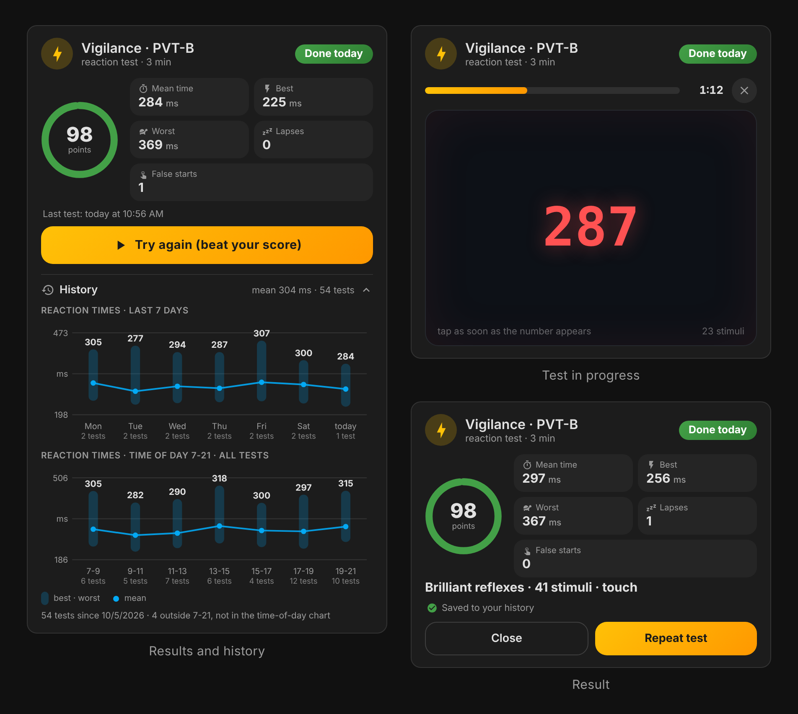
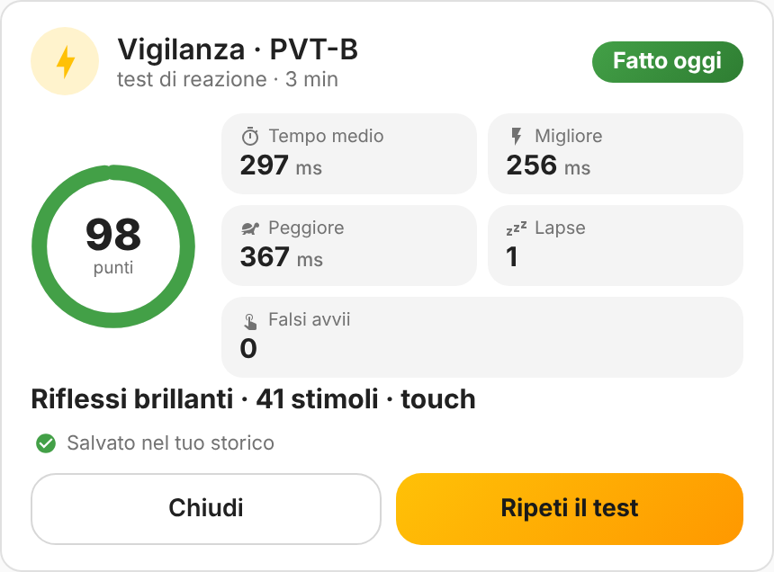

# PVT-B Vigilance Card

[](https://hacs.xyz/docs/faq/custom_repositories/)
[](https://github.com/artech-lab/pvt-vigilance-card/releases)
[](https://github.com/artech-lab/pvt-vigilance-card/actions/workflows/validate.yml)
[](LICENSE)

**English** | [Italiano](README.it.md)

A Home Assistant dashboard card that runs the **3-minute brief Psychomotor Vigilance Test (PVT-B)**
and keeps a persistent history of your reaction times. Add the card and start testing:
no helpers, no YAML, no restarts.



<sub>Screenshots made with demo data.</sub>

## Features

- **Standard PVT-B protocol**: 3 minutes, random wait of 1-4 s between stimuli, lapse threshold 355 ms,
  false start below 100 ms ([Basner et al., 2011](https://pubmed.ncbi.nlm.nih.gov/22025811/)).
- **Clear feedback**: a running millisecond counter as stimulus, your time after every tap, a progress bar
  and a short vibration on phones.
- **Results**: score 0-100, mean, best and worst reaction time, lapses and false starts, plus a short verdict.
- **Persistent history** saved by Home Assistant itself: reaction times of the last 7 days and a time-of-day
  profile built from all your tests, drawn like the native statistics graphs.
- **Repeatable measurements** across devices: frame-accurate stimulus onset, hardware event timestamps,
  warm-up trials and optional latency compensation for touch, mouse and keyboard.
- **Works out of the box**, with a visual editor for every option.
- **English and Italian**, following the language of your Home Assistant profile.
- **One-click helpers** (optional): from the card editor, administrators can create and link
  `input_number` / `input_datetime` / `counter` helpers and statistics sensors, for automations, goal cards,
  Home Assistant's own graphs and a permanent backup of the results in the long-term statistics.
- **Native look**: theme colours, light and dark mode, sections layout, keyboard accessible.

## Installation

### HACS (recommended)

[](https://my.home-assistant.io/redirect/hacs_repository/?owner=artech-lab&repository=pvt-vigilance-card&category=plugin)

1. Click the button above, or in HACS open the menu (⋮) > **Custom repositories** and add
   `https://github.com/artech-lab/pvt-vigilance-card` with type **Dashboard**.
2. Download **PVT-B Vigilance Card**.
3. Reload the browser (or restart the companion app).

From Home Assistant 2026.11, HACS is built in as the **Marketplace**: the steps are the same.
HACS registers the dashboard resource automatically. If your dashboards are in YAML mode, add
`/hacsfiles/pvt-vigilance-card/pvt-vigilance-card.js` as a resource of type `module`.

### Manual

1. Download `pvt-vigilance-card.js` from the [latest release](https://github.com/artech-lab/pvt-vigilance-card/releases/latest).
2. Copy it to `/config/www/pvt-vigilance-card.js`.
3. Settings > Dashboards > ⋮ > **Resources** > Add resource: URL `/local/pvt-vigilance-card.js`, type **JavaScript module**.
4. Reload the browser.

## Usage

Edit a dashboard, add a card and pick **PVT-B Vigilance Card**, or paste:

```yaml
type: custom:pvt-vigilance-card
```

That is all. Press **Start test**, then tap the dark area (click it, or press **Space**) as soon as the
red counter appears. The test lasts 3 minutes; the first stimuli are a warm-up and are not scored.

For results you can compare over time:

- use the same device and the same input (finger, mouse or keyboard) every time;
- sit comfortably, in a quiet place, and keep the app in the foreground until the end
  (a test interrupted by a hidden page is discarded);
- test at similar times of day, or use the time-of-day chart to see how your vigilance changes.



## How the test is scored

| Measure | Definition |
| --- | --- |
| Reaction time | Time from the frame that shows the stimulus to your response, minus the optional input compensation |
| Lapse | Reaction time ≥ lapse threshold (355 ms), or no response within 3 s |
| False start | Response while waiting for the stimulus, or reaction time below 100 ms |
| Score | `100 × (1 − (lapses + false starts) / (scored stimuli + false starts while waiting))` |

The verdict is *Brilliant reflexes* (score ≥ 90 and mean ≤ 320 ms), *Good vigilance* (≥ 85),
*Attention dropping* (≥ 70) or *Very tired: consider a break*.

## Configuration

Every option is available in the visual editor. All of them are optional.

| Option | Default | Description |
| --- | --- | --- |
| `title` | localized | Card title |
| `icon` | `mdi:lightning-bolt` | Header icon |
| `duration` | `180` | Test length in seconds (30-600) |
| `isi_min` / `isi_max` | `1` / `4` | Random wait between stimuli, in seconds |
| `lapse_ms` | `355` | Reaction time counted as a lapse |
| `warmup` | `2` | First stimuli excluded from the results (0-5) |
| `offset_touch` | `0` | Milliseconds subtracted from touch responses |
| `offset_mouse` | `0` | Milliseconds subtracted from mouse responses |
| `offset_keyboard` | `0` | Milliseconds subtracted from Space / Enter responses |
| `show_history` | `true` | Show the history section |
| `band_start` / `band_end` | `7` / `21` | Hours covered by the time-of-day chart |
| `band_size` | `2` | Hours per bar in the time-of-day chart |
| `score_entity` | – | `input_number` that receives the score |
| `mean_entity` / `best_entity` / `worst_entity` | – | `input_number` helpers for the reaction times (ms) |
| `lapses_entity` / `false_entity` | – | `input_number` helpers for lapses and false starts |
| `last_entity` | – | `input_datetime` (date and time) that receives the time of the test |
| `count_entity` | – | `counter` incremented after every test |
| `stat_mean_entity` / `stat_best_entity` / `stat_worst_entity` / `stat_count_entity` | – | Statistics sensors used to [rebuild the history](#rebuilding-the-history-from-helpers) |

A complete example is in [`examples/full.yaml`](examples/full.yaml).

## History and data storage

Results are saved with Home Assistant's **frontend user data** storage, the same mechanism the interface
uses for your personal settings:

- nothing to configure and no entities are created;
- data lives on your Home Assistant server (in `.storage`), so it is included in backups and is the same
  on every device where you log in with the same user;
- every Home Assistant user has a separate history, which is what you want when several people test;
- the recorder purge does not affect it; the card keeps the latest 5,000 tests.

The last 7 days chart shows, for each day, a capsule from the best to the worst reaction time and a dot
for the mean. The time-of-day chart uses every test you have ever saved, so it gets more reliable over time.

## Accuracy and repeatability

Browsers add latency that changes between devices. The card reduces it where software can:

- **Stimulus onset** is the timestamp of the frame in which the counter is actually painted, not the moment
  it was requested, so rendering delays are excluded.
- **Responses** use the hardware timestamp of the input event, so a busy page does not slow your time down.
- **Warm-up** trials absorb the slower first reactions.
- **Input compensation**: touchscreens usually add 50-80 ms compared with a mouse, a delay that software
  cannot measure. To compare devices, take 3-4 tests on each in similar conditions, then set the difference
  of the mean times as `offset_touch` (or `offset_mouse`). The result screen shows the input that was used.

Comparing results on the same device remains the most reliable approach.

## Optional: helpers for automations, goals and backup

The card needs no helpers. To use the results outside the card, edit the card and press **Create helpers**
at the bottom of the editor (administrators only). In one click the card:

- creates six `input_number` helpers (score, mean, best and worst time, lapses, false starts), an
  `input_datetime` for the time of the test and a `counter`, with fixed English names (for example
  *PVT-B Mean time*, entity `input_number.pvt_b_mean_time`), the same in every language;
- creates four template sensors, *PVT-B History mean time*, *best time*, *worst time* and *test count*,
  with `state_class: measurement`. They hold a value only in the 90 seconds after a test, so their
  long-term statistics keep a permanent copy of your results, one row per test, which the recorder purge
  does not remove;
- creates a *PVT-B Score today* sensor, unknown until the first test of the day: ideal for daily goals;
- links everything to the card. Then save the card.

Helpers that are already linked, or that already exist with the same names, are reused: pressing the button
again never creates duplicates. You can rename or delete the helpers from Settings > Devices & services >
Helpers. If you prefer YAML, the package [`examples/packages/pvt_vigilance.yaml`](examples/packages/pvt_vigilance.yaml)
creates the same entities.

After every test the card writes the values first, then increments the counter, then sets the date and
time, so automations triggered by the date always read up-to-date values.

Helpers are shared by every Home Assistant user, while the history of the card is personal: if several
people take the test on the same card, the helpers mix their results.

## Rebuilding the history from helpers

When the history of the card is empty (for example after a reset, or for results recorded before you
installed the card), the card **rebuilds it once, automatically**, from:

- the long-term statistics of the statistics sensors (`stat_*_entity` options: mean, best and worst time
  and a running test count, one row per hour), and
- the recent recorder history of `mean_entity`, `best_entity`, `worst_entity` and `last_entity`.

Rows that only repeat the previous hour and values restored by a Home Assistant restart are not counted
as new tests. Sensors you created yourself work too, as long as they have `state_class: measurement`.

If you previously installed the card by hand, remove that copy from Settings > Dashboards > Resources (for
example a `/local/...` file), so that only the HACS resource remains. If two copies are loaded the browser
console shows a warning starting with `PVT-VIGILANCE-CARD`.

## Languages

The card follows the language of your Home Assistant user profile: English and Italian are included, any
other language falls back to English. To add one, copy the `en` block of `PVT_I18N` in
[`dist/pvt-vigilance-card.js`](dist/pvt-vigilance-card.js), translate the strings and open a pull request:
the unit tests check that every key and placeholder is present.

## Troubleshooting

- **"Custom element doesn't exist: pvt-vigilance-card"**: the resource is missing or cached. Check
  Settings > Dashboards > Resources, then reload the page clearing the cache.
- **The history is empty on another device**: you are logged in with a different Home Assistant user.
- **"Test interrupted"**: the page was hidden (app switched, screen off) during the test. Run it again.
- **No "Create helpers" button**: only administrators can create helpers; ask one to press it once.
- **"Could not create every helper"**: the helpers created before the error stay linked. Fix the cause shown
  in the message, then press the button again: it continues where it stopped.
- **Times look higher than expected on a phone**: that is touchscreen latency; see
  [Accuracy and repeatability](#accuracy-and-repeatability).

## Development

The card is a single dependency-free file, [`dist/pvt-vigilance-card.js`](dist/pvt-vigilance-card.js),
with no build step.

```bash
npm test             # unit tests of scoring, history, helpers and translations (Node 20+)
npm install && npx playwright install chromium   # once, for the two commands below
npm run test:e2e     # browser tests with a simulated Home Assistant
npm run screenshots  # regenerates the images in images/ with demo data
```

The project includes a [`CLAUDE.md`](CLAUDE.md) guide and slash commands for
[Claude Code](https://claude.com/claude-code) (`/publish`, `/release`).

## Disclaimer

This card is a self-assessment tool for personal use. It is **not a medical device** and must not be used
to diagnose conditions or to decide whether you are fit to drive or to work.

## References

Basner M, Mollicone D, Dinges DF. *Validity and sensitivity of a brief psychomotor vigilance test (PVT-B)
to total and partial sleep deprivation.* Acta Astronautica, 2011.
[PubMed 22025811](https://pubmed.ncbi.nlm.nih.gov/22025811/)

## License

Copyright © 2026 The pvt-vigilance-card contributors. Released under the
[GNU General Public License v3.0 or later](LICENSE).
